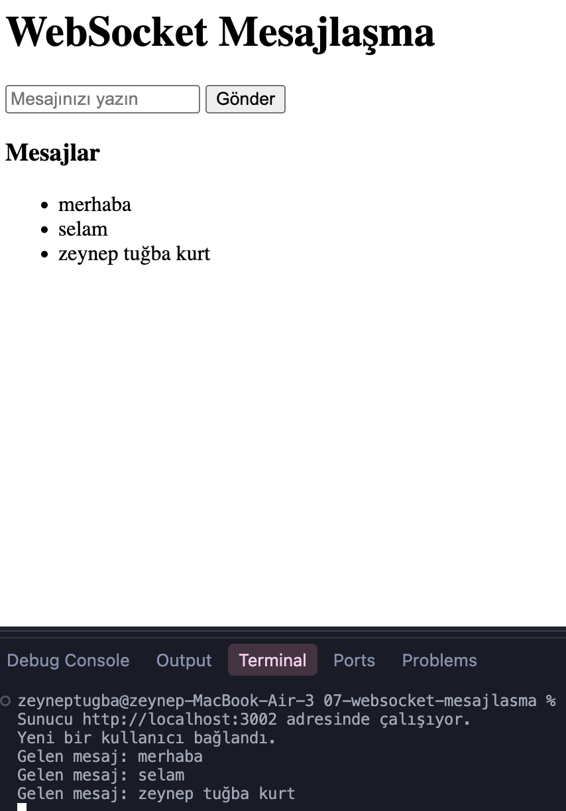

# WebSocket Mesajlaşma Uygulaması

Node.js, Express ve WebSocket kullanılarak geliştirilen gerçek zamanlı mesajlaşma uygulaması.

## Özellikler
- WebSocket bağlantısı kurma
- Tarayıcıdan sunucuya mesaj gönderme
- Mesajları bağlı istemcilere iletme
- Sayfayı yenilemeden mesajları görüntüleme
- Bağlantı açılma ve kapanma olaylarını takip etme

## Kullanılan Teknolojiler
- Node.js
- Express.js
- WebSocket (ws)
- HTML
- JavaScript

## Kurulum

```bash
npm install
```

## Çalıştırma

```bash
node index.js
```

Tarayıcıdan `http://localhost:3002/` adresini açın.

Mesajların birden fazla tarayıcı sekmesi arasında iletilmesini test edebilirsiniz.

