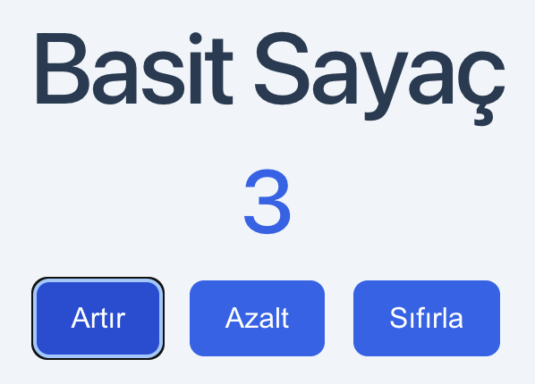
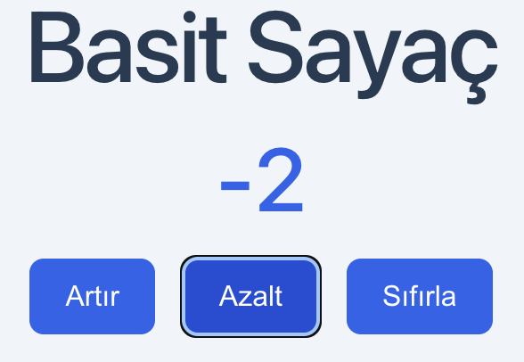
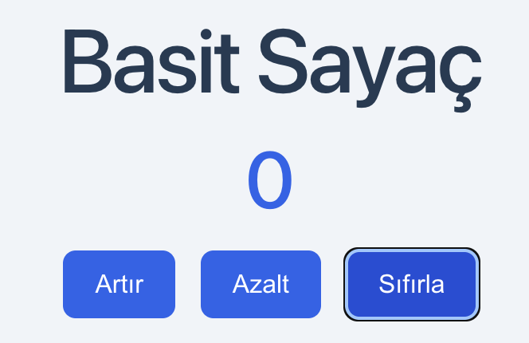

# React Basit Sayaç

React ve Vite kullanılarak geliştirilmiş basit bir sayaç uygulamasıdır.

## Özellikler
- Sayıyı artırma
- Sayıyı azaltma
- Sayacı sıfırlama

## Kullanılan Teknolojiler
- React
- Vite
- JavaScript
- CSS

## Çalıştırma

```bash
npm install
npm run dev
```

## Örnek Görseller



