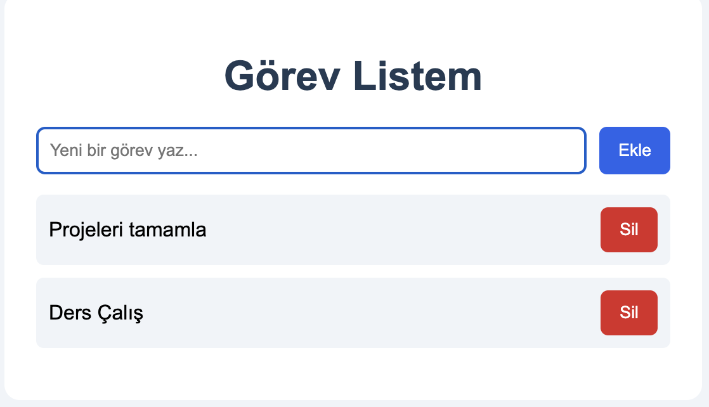
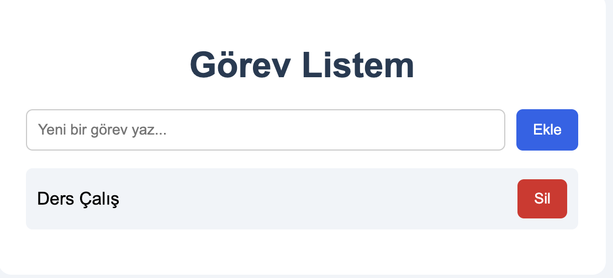
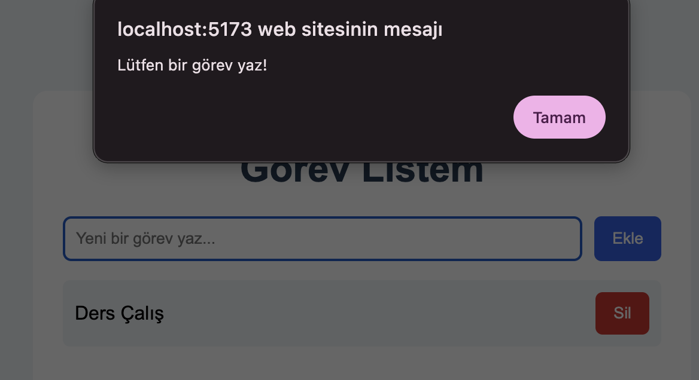

# Vite Mini Uygulama

Vite ve JavaScript kullanılarak geliştirilmiş basit bir görev listesi uygulamasıdır.

## Özellikler
- Görev ekleme
- Görev silme
- Boş görev kontrolü

## Kullanılan Teknolojiler
- Vite
- HTML
- CSS
- JavaScript

## Çalıştırma

```bash
npm install
npm run dev
```

## Örnek Görseller



