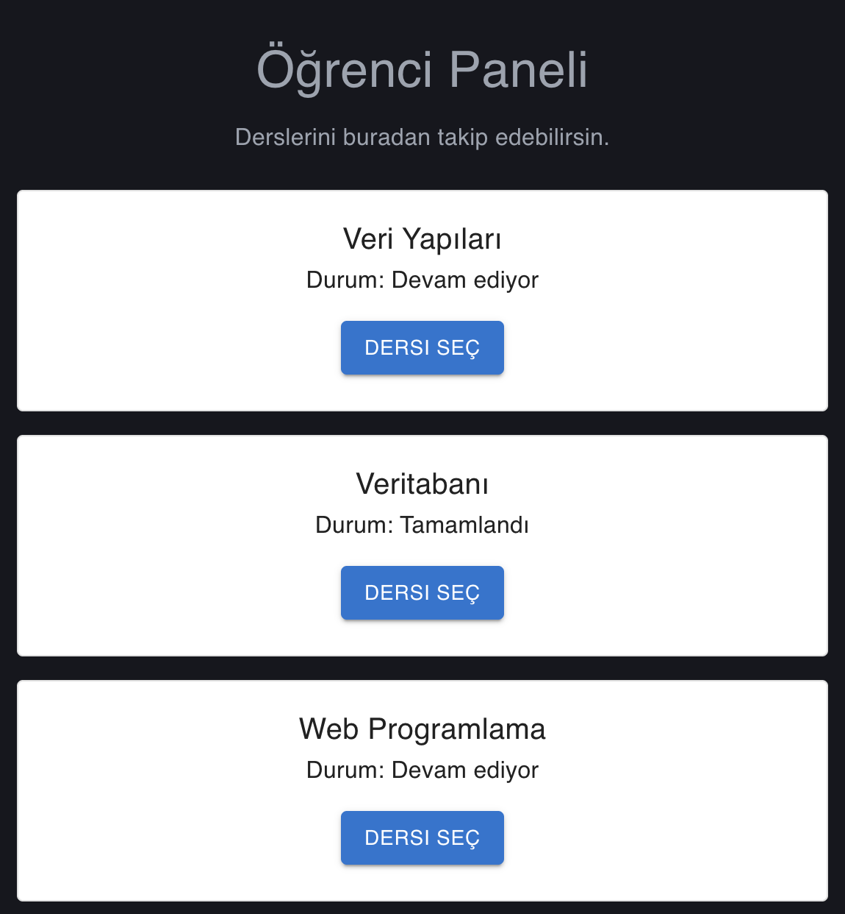

# MUI Öğrenci Paneli

React ve Material UI kullanılarak geliştirilmiş basit bir öğrenci panelidir.

## Özellikler
- Ders kartlarını görüntüleme
- Ders seçme butonları
- Seçilen dersi ekranda gösterme

## Kullanılan Teknolojiler
- React
- Vite
- Material UI

## Çalıştırma

```bash
npm install
npm run dev
```

## Örnek Görseller


