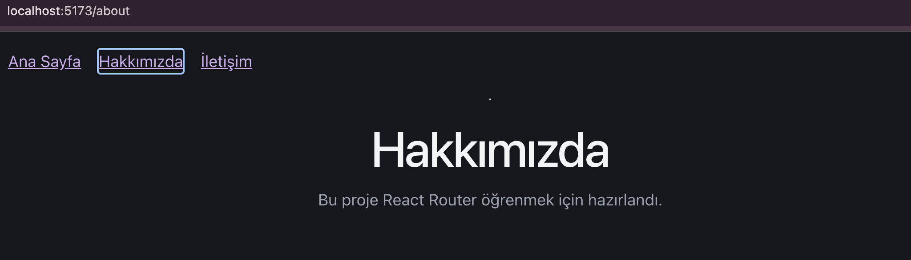
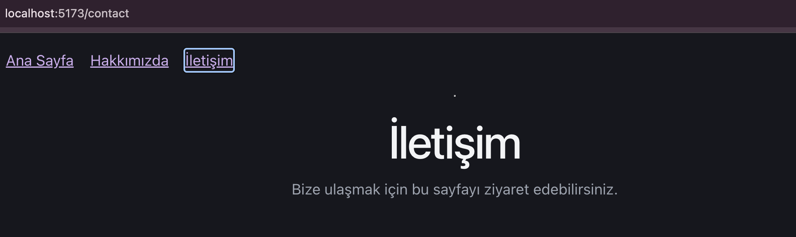

# React Router

## Projenin Amacı
React Router kullanarak React uygulamasında sayfalar arasında geçiş yapmak.

## Kullanılan Teknolojiler
- React
- Vite
- React Router

## Özellikler
- Ana Sayfa
- Hakkımızda sayfası
- İletişim sayfası
- Sayfalar arası yönlendirme

## Çalıştırma
```bash
npm install
npm run dev
```

## Örnek Görseller




