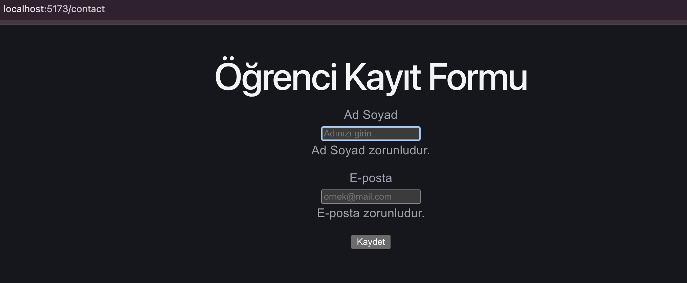
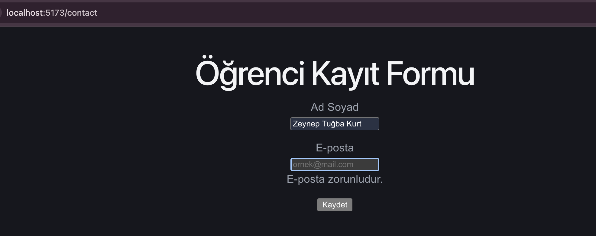
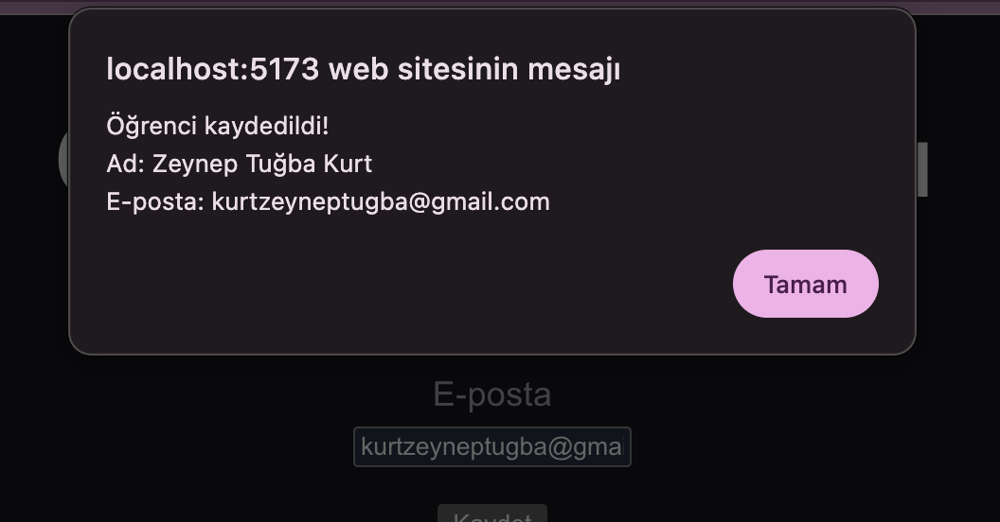

# React Hook Form

## Projenin Amacı
React Hook Form kullanarak öğrenci kayıt formu oluşturmak ve form doğrulaması yapmak.

## Kullanılan Teknolojiler
- React
- Vite
- React Hook Form

## Özellikler
- Ad Soyad ve e-posta alanları
- Zorunlu alan kontrolü
- E-posta formatı doğrulama
- Form gönderimi ve hata mesajları

## Çalıştırma
```bash
npm install
npm run dev
```

## Örnek Görseller



