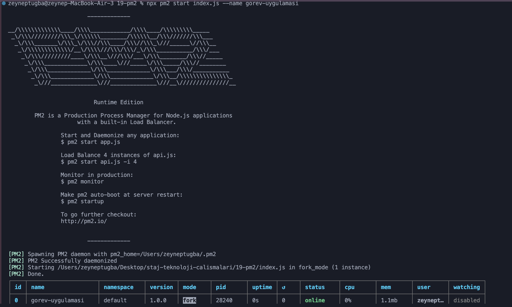
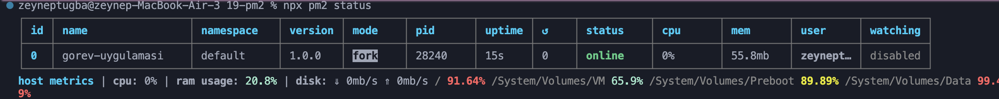
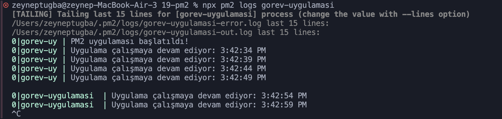
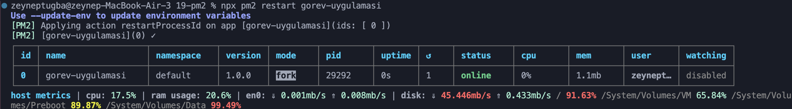
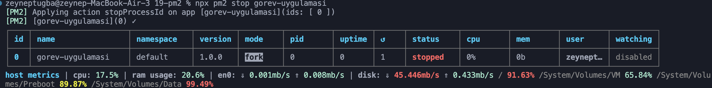
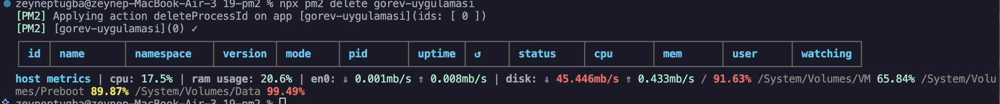

# 19 - PM2

## Projenin Amacı
PM2 kullanarak Node.js uygulamasını çalıştırmak ve yönetmek.

## Kullanılan Teknolojiler
- Node.js
- PM2

## Özellikler
- Uygulamayı arka planda çalıştırma
- Uygulama durumunu görüntüleme
- Logları takip etme
- Uygulamayı yeniden başlatma ve durdurma

## Kurulum

```bash
npm install
```

## Uygulamayı Başlatma

```bash
npx pm2 start index.js --name gorev-uygulamasi
```


## PM2 Komutları

Durumu görüntüleme:

```bash
npx pm2 status
```


Logları görüntüleme:

```bash
npx pm2 logs gorev-uygulamasi
```


Yeniden başlatma:

```bash
npx pm2 restart gorev-uygulamasi
```


Durdurma:

```bash
npx pm2 stop gorev-uygulamasi
```


Uygulamayı listeden silme:

```bash
npx pm2 delete gorev-uygulamasi
```

