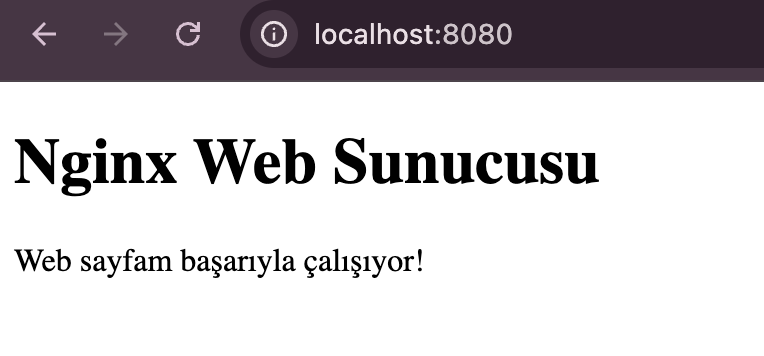

# Nginx

Bu projede Nginx'in web sunucusu olarak nasıl çalıştığını öğrendim ve basit bir HTML sayfasını yerel ortamda yayınladım.

### Kullanılan Teknolojiler
- Nginx
- HTML
- Homebrew

### Yapılan Çalışmalar
- Nginx kurulumu ve başlatılması
- HTML sayfasının web sunucusu üzerinden yayınlanması
- Nginx servis komutlarının öğrenilmesi

## Çalıştırma
 
```bash
brew services start nginx
```

 `http://localhost:8080`

## Çalıştırma sonrası görsel

