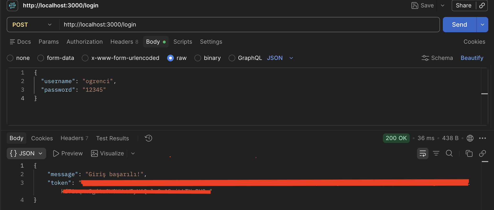
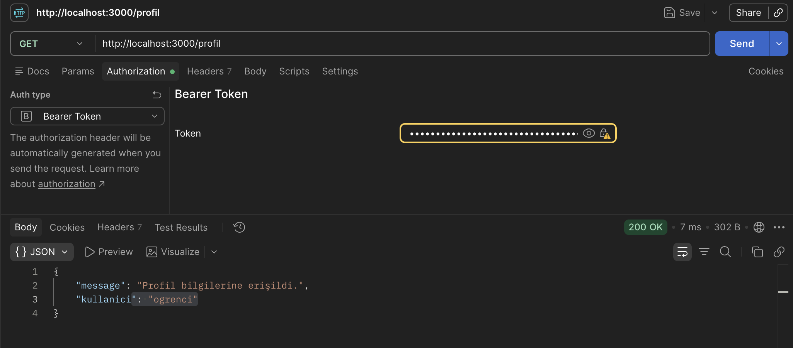

# JWT

## Projenin Amacı
JWT kullanarak kullanıcı kimlik doğrulaması yapmak ve korunan endpoint'lere erişimi kontrol etmek.

## Kullanılan Teknolojiler
- Node.js
- Express
- JSON Web Token (JWT)
- dotenv

## Özellikler
- Kullanıcı girişi
- JWT token oluşturma
- Token doğrulama
- Token ile profil bilgilerine erişim
- Hatalı veya eksik token kontrolü

## Kurulum

```bash
npm install
```

`.env` dosyasına `JWT_SECRET` değişkenini ekleyin.

## Çalıştırma

```bash
node index.js
```

Sunucu `http://localhost:3000` adresinde çalışır.


## Endpoint'ler

| Metot | Adres | Açıklama |
|---|---|---|
| POST | `/login` | Giriş yapar ve token üretir. |
| GET | `/profil` | Geçerli token ile profil bilgilerini döndürür. |

## Test Kullanıcı Bilgileri

- Kullanıcı adı: `ogrenci`
- Şifre: `12345`

### GET



### POST

