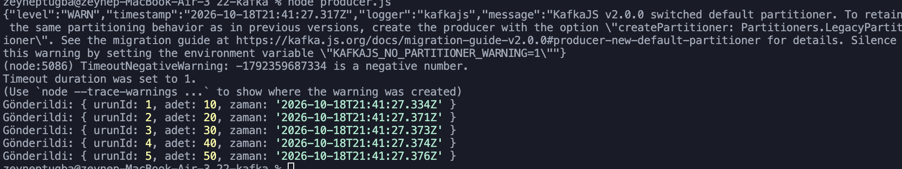
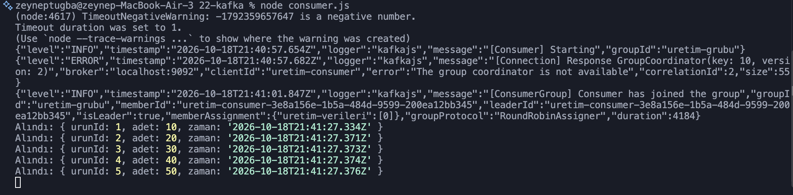

# Apache Kafka

## Projenin Amacı
Apache Kafka ile mesajlaşma ve veri akışı mantığını öğrenmek. Bir üretim takip sistemi örneğinde Producer üretim verilerini Kafka'ya gönderir, Consumer bu verileri okuyup terminale yazdırır.

## Kullanılan Teknolojiler
- Node.js
- Apache Kafka
- KafkaJS

## Özellikler
- Kafka'da topic oluşturma
- Producer ile üretim verisi gönderme
- Consumer ile mesajları okuma
- Mesajların JSON formatında taşınması

## Kurulum

```bash
npm install
```

Kafka klasöründe `uretim-verileri` topic'ini oluşturun:

```bash
bin/kafka-topics.sh --create --topic uretim-verileri --bootstrap-server localhost:9092
```

> Mac dili Türkçe ise Kafka'yı başlatmadan önce şu ayar gerekir (aksi halde `CLASSİC` hatası alınır):
> `export KAFKA_OPTS="-Duser.language=en -Duser.country=US"`

## Çalıştırma

Kafka'yı başlatın:

```bash
bin/kafka-server-start.sh config/server.properties
```

Ayrı bir terminalde Consumer'ı çalıştırın:

```bash
node consumer.js
```

Üçüncü bir terminalde Producer'ı çalıştırın:

```bash
node producer.js
```

## Dosyalar

| Dosya | Açıklama |
|---|---|
| `producer.js` | Üretim verilerini Kafka'ya gönderir. |
| `consumer.js` | Kafka'daki mesajları okuyup yazdırır. |

## Örnek Çıktı

### Producer



### Consumer

